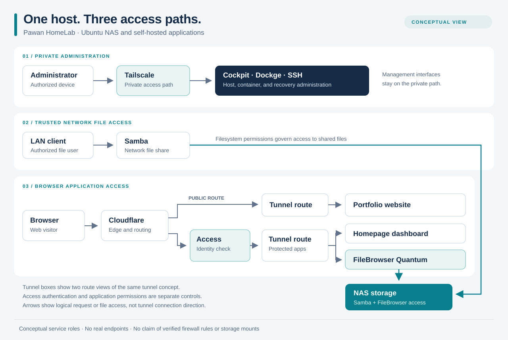

  

# Pawan HomeLab & NAS
### Turning an everyday laptop into a practical Linux server.

**File storage · Containerized applications · Browser-based management · Remote access**

A personal infrastructure project that repurposes a **Samsung Galaxy Book Flex** into an **Ubuntu Server** NAS and application host. It combines network file sharing, a self-hosted portfolio, graphical administration, and separate paths for private management and web access.

[Project case study](case-study.md) · [Architecture](architecture.md) · [Troubleshooting](troubleshooting.md) · [Roadmap](roadmap.md)

---

## The project in 30 seconds

| | |
| :--- | :--- |
| **The need** | Centralize files, host a personal website, and manage services without relying on terminal commands for every routine task. |
| **The build** | Ubuntu Server on reused laptop hardware, LVM storage roles, Docker applications, Samba, and browser-based management. |
| **The access design** | Tailscale for private administration; Cloudflare Tunnel for selected web routes; Cloudflare Access for protected applications. |
| **The learning** | Linux administration, storage organization, container operations, file permissions, access boundaries, and configuration debugging. |
| **Project type** | Personal HomeLab implementation with sanitized engineering documentation. |

## What the lab brings together

- **A shared file hub:** Samba for network clients and FileBrowser Quantum for browser-based file management.
- **A home for applications:** Docker workloads managed through Dockge, including a personal portfolio website.
- **A clearer management experience:** Cockpit for the host and Homepage as a central service directory.
- **Two remote-access paths:** private administration through Tailscale and selected web applications through Cloudflare.
- **A documented learning process:** practical tradeoffs, a real YAML troubleshooting case, and a staged improvement plan.

## System overview

*Conceptual architecture based on the project record. The cover is an AI-generated illustration, not a photo of the actual host. See [visual notes](visuals.md).*

## Technical skills in context

| Skill area | How it appears in the project | Explore |
| :--- | :--- | :--- |
| Linux administration | Headless Ubuntu host, SSH, service inspection, Cockpit | [Operations](operations.md) |
| Storage design | Separate LVM responsibilities for OS, Docker, NAS, and websites | [Hardware & storage](hardware-and-storage.md) |
| Container operations | Docker applications and Compose stack management with Dockge | [Service catalog](service-catalog.md) |
| File services | Network shares, browser access, and permission boundaries | [Samba & FileBrowser](file-services.md) |
| Networking & access | Tailscale, Cloudflare Tunnel, and Access authentication | [Networking](networking.md) |
| Troubleshooting | Diagnosed an appended YAML line and corrected the intended service block | [Incident case study](troubleshooting.md) |
| Technical communication | Architecture, operating notes, safe examples, and explicit tradeoffs | [Project case study](case-study.md) |

## A concrete problem solved

When changing the NAS shortcut from a private address to a web hostname, replacement text was appended as a malformed YAML line. The correction removed that line and placed separate `href` and `ping` values inside the right service entry.

The project record contains the corrected configuration excerpt. [Read the root cause, corrected example, and verification steps →](troubleshooting.md)

## Read the project your way

| For a quick overview | For a technical review |
| :--- | :--- |
| [Project story & decisions](case-study.md) | [Architecture & boundaries](architecture.md) |
| [Service catalog](service-catalog.md) | [Hardware & LVM roles](hardware-and-storage.md) |
| [What comes next](roadmap.md) | [Operations](operations.md) · [Networking](networking.md) |
| [Visual guide](visuals.md) | [Examples](examples.md) · [Security](security.md) |

## Next steps

The next priorities are a verified hardware/version baseline, tested backup recovery, and service monitoring. A read-only NAS assistant, additional websites, Navidrome, and IoT experiments are future work. [See the staged roadmap →](roadmap.md)

<strong>Evidence, scope, and privacy</strong>

The implemented stack is described in the original project discussion. The available evidence includes a user-provided Homepage configuration excerpt; other setup details come from the project summary. Exact versions, disk capacities, current policy enforcement, uptime, and performance were not independently measured for this publication.

This repository is a portfolio case study, not an automated installer or live security assessment. Examples are authored with reserved domains and generic paths. Private hostnames, network addresses, credentials, raw logs, and private configuration exports are excluded. Planned work is labeled separately.

---

Built as a personal learning project by [Pawan-EE](https://github.com/Pawan-EE). For technical discussion, open an issue without including private server information.
