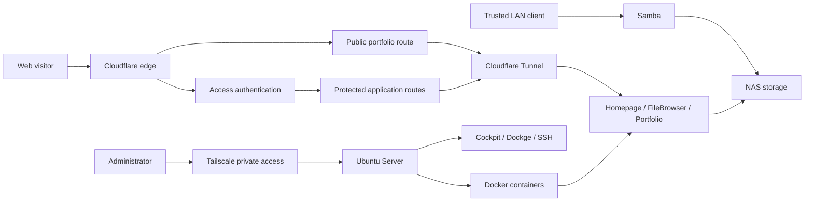

# Pawan HomeLab & NAS

An Ubuntu Server HomeLab built by repurposing a Samsung Galaxy Book Flex into a headless NAS, container host, and self-hosted website platform.

The project brings storage, web-based administration, and remote access together on existing hardware. It documents practical Linux administration, container operations, network access design, and troubleshooting.

## Project status

This is a sanitized portfolio record of the setup reported in the original project discussion. It is **not a live audit of the server** or a complete deployment bundle. The available discussion includes a corrected Homepage configuration excerpt; several other accomplishments are recorded in the prior project summary rather than independently measured here. Exact software versions, disk sizes, and current access policies remain to be verified.

| Area | Recorded implementation |
| --- | --- |
| Host | Samsung Galaxy Book Flex running Ubuntu Server |
| Storage | LVM separation for OS, Docker, NAS data, and websites |
| Containers | Docker with Dockge for graphical Compose stack management |
| Host administration | Cockpit and SSH |
| Dashboard | Homepage with service shortcuts and container status entries |
| File sharing | Samba and FileBrowser Quantum |
| Private remote access | Tailscale |
| Web access | Cloudflare Tunnel, custom-domain routing, and Cloudflare Access email OTP |
| Hosting | Containerized personal portfolio website |

## Architecture

The diagram communicates service roles and intended access boundaries; it does not expose deployment addresses or attest that every firewall rule is currently enforced. See [architecture](architecture.md).

## Explore the project

- [Hardware and storage](hardware-and-storage.md)
- [Docker, Dockge, Cockpit, and Homepage](operations.md)
- [Samba and FileBrowser Quantum](file-services.md)
- [Tailscale, Cloudflare Tunnel, and Access](networking.md)
- [Security and publication boundaries](security.md)
- [Troubleshooting and lessons learned](troubleshooting.md)
- [Roadmap](roadmap.md)
- [Sanitized examples](examples.md)

## Engineering decisions

- Reuse existing hardware for a practical learning platform.
- Separate storage responsibilities so application state and user files can be managed deliberately.
- Use graphical tools for common tasks while retaining SSH for diagnosis and recovery.
- Treat private administration and browser-based application access as different access paths.
- Keep actual deployment configuration and secrets outside the public repository.

## Using this repository

Read the architecture and security notes first. Examples use reserved domains and generic paths, are deliberately incomplete, and must be adapted and tested locally. They are **not copies of private production configuration**. No command in this repository is required to run automatically.

## Evidence and limitations

The original discussion reports the services above as installed. A user-provided Homepage excerpt demonstrates the NAS shortcut correction documented in troubleshooting. No live server login, performance test, disk inventory, backup restore, or security audit was performed for this publication. Proposed improvements are kept in the roadmap.

No credentials, real service domains, network addresses, personal login names, storage identifiers, or raw logs are included.
