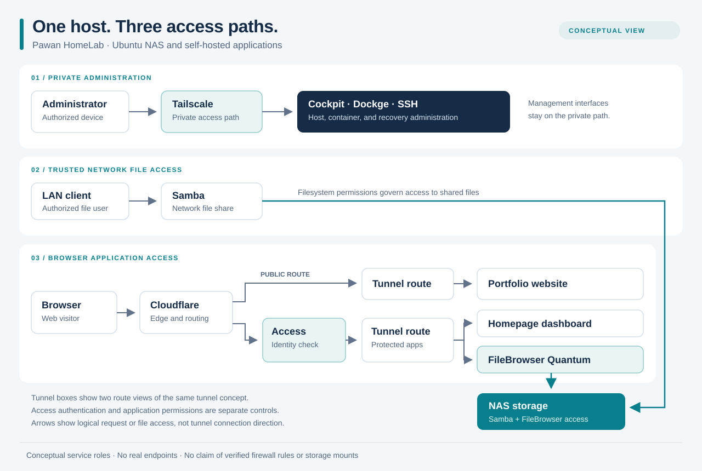

# Architecture & access boundaries

[← Project overview](README.md)

## Three paths, one host

| Path | Sequence | Purpose |
| --- | --- | --- |
| Private administration | Administrator → Tailscale → Cockpit / Dockge / SSH | Manage the host and applications |
| Trusted file sharing | Authorized LAN client → Samba → NAS files | Use network shares |
| Browser access | Visitor → Cloudflare edge → selected route → Tunnel → web application | Reach a public site or a protected application |

Protected web routes include Cloudflare Access before the origin application. The portfolio's public route is separate. FileBrowser still needs appropriate application accounts and file permissions.

## Host organization

Ubuntu Server provides the host environment. Docker runs application workloads; Dockge manages Compose stacks. Cockpit provides host administration, and Homepage provides service navigation.

The storage design described in the project separates OS, Docker, NAS, and website responsibilities using LVM. Exact volume names, capacities, and filesystem types are not reproduced.

## Application boundaries

- **FileBrowser Quantum** accesses the NAS files it is configured to serve.
- **Samba** exposes authorized shares to trusted network clients.
- **Homepage** links to services; the diagram does not imply it mounts NAS files.
- **The portfolio** serves website content; it is not shown with access to user files.
- **Dockge and the Docker API** belong to the privileged administration boundary.

The drawing presents logical roles, not a packet-level diagram, a live policy export, or an exact container deployment topology. Application-to-storage links represent purpose; actual mount scope must be checked privately.

## Failure and recovery considerations

A single host ties together storage, management, and hosted applications. A host outage can affect all of them. LVM separates responsibilities but does not create an independent backup or redundant hardware.

Tunneled web access depends on the origin, connector, Internet path, and edge service. Retain a tested local/private recovery path. Storage mounts and application state must be restored before bringing affected services back.

## Design checks

Confirm that administrative services are reachable only by intended users, protected applications cannot be reached through a bypass route, and each application receives only the data it needs. These checks are [roadmap validation tasks](roadmap.md), not claims of completed auditing.

[Networking details →](networking.md) · [Storage design →](hardware-and-storage.md)
