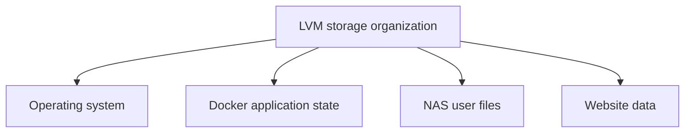

# Hardware & storage design

[← Project overview](README.md)

## Reusing the hardware

The project turns a Samsung Galaxy Book Flex into a headless Ubuntu NAS and application host. This gives existing hardware a new role while creating a practical environment for Linux and infrastructure learning.

| Component | Project record |
| --- | --- |
| Host | Samsung Galaxy Book Flex |
| CPU | Intel Core i5 mentioned in the discussion; exact model to verify |
| RAM | 8 GB mentioned in the discussion; inventory confirmation pending |
| Operating system | Ubuntu Server; exact release to record |
| Physical storage | Disk model, capacity, and health to verify |
| Operating mode | Headless NAS and application host |

No device serial numbers, UUIDs, MAC addresses, or private host identifiers are published.

## Storage by responsibility

*Logical roles described in the project summary. This is not an exact partition map.*

| Responsibility | What belongs here | Why the distinction matters |
| --- | --- | --- |
| OS | Host software and system configuration | Application data should not unexpectedly consume the root filesystem |
| Docker | Persistent application state and configuration | Recreating a container is different from recovering its data |
| NAS | Shared user files and permissions | File ownership and access need deliberate management |
| Websites | Site content and deployment state | Website recovery should include content, not just the server image |

Actual logical-volume names, filesystem types, sizes, and mount points remain private or unverified. Example paths are generic substitutes.

## Inventory before changing storage

Read-only inspection can establish the real layout:

| Inspect | Tool | What to establish |
| --- | --- | --- |
| Block devices and filesystems | `lsblk -f` | Which filesystems belong to which devices |
| Filesystem usage | `df -hT` | Capacity and filesystem type |
| LVM organization | `pvs`, `vgs`, `lvs` | Physical volumes, volume groups, and logical volumes |
| Mounts | `findmnt` | Whether data is mounted at the intended path |

Keep raw output private because it may contain identifiers. Do not resize, format, repartition, or recursively change ownership based on this public document.

## Reliability considerations

- Confirm persistent mounts before starting applications after a reboot.
- If a mount is missing, stop affected writes before data fills the OS filesystem.
- Check ventilation, temperature, battery condition, and lid/suspend behavior.
- Keep an independent backup and test recovery.

LVM separation is organization, not redundancy. A laptop battery also does not establish a tested backup or power-recovery strategy.

[Recovery roadmap →](roadmap.md) · [Private inventory worksheet →](deployment-worksheet.md)
