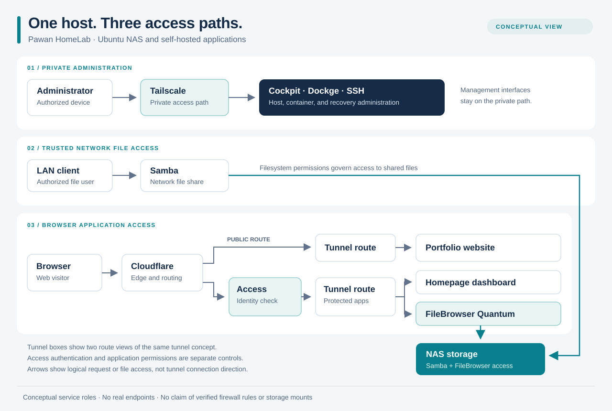

# Visual guide & provenance

[← Project overview](README.md)

## Project cover

The cover is an original AI-generated **concept illustration** for this portfolio. It represents reused laptop hardware, files, containers, and remote connectivity. It is not a photograph, product screenshot, or proof of installed hardware.

## Architecture drawing

The SVG is an original editable diagram of the project's logical service roles. It omits real endpoints and private identifiers. Arrows communicate access or data relationships, not exact packet flow or a live configuration export.

## Authentic screenshots

The available project discussion contains configuration excerpts but no usable original host photos or application screenshots. No product mockup is passed off as the running installation.

Future screenshots should be captured from the actual lab and reviewed for domains, addresses, account names, directory names, tokens, and personal files before publication. Suggested subjects: Homepage navigation, a Dockge stack overview, and a Cockpit resource view with identifiers removed.

## Cover production note

Created with the built-in image generator. Prompt: a restrained wide technical illustration of a repurposed convertible laptop connected to abstract file storage, container blocks, and a cloud; dark navy, teal, and amber; no text, logos, real dashboard, performance figures, or actual host identifiers.
